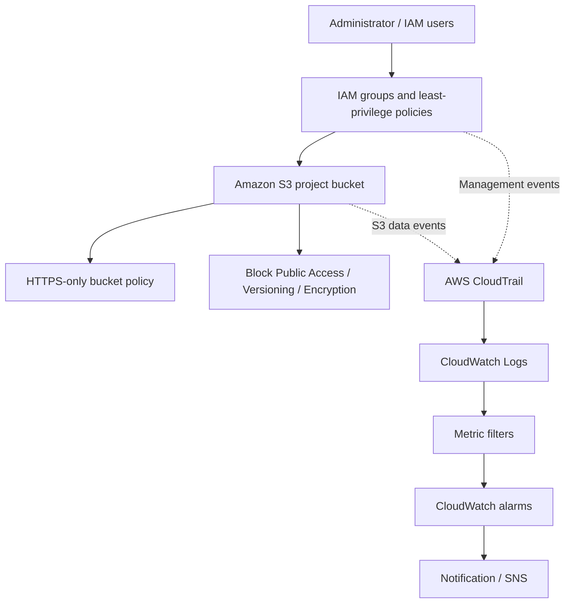

# Project architecture

## Intended architecture from the project plan

## Separation of storage and audit logs

The supplied S3 bucket inventory showed a project-storage candidate named `hemanth-1234` in `eu-north-1` and a separate CloudTrail log-delivery bucket in `ap-south-2`. Keep these as separate resources in diagrams and evidence.

## Observed-state caveats

- The CloudTrail trail screenshot showed multi-region enabled but trail logging Off.
- The CloudTrail trail screenshot showed SNS notification delivery disabled.
- A CloudWatch Logs group with three metric filters was visible, but filter names/patterns and alarm configuration were not provided.
- The CloudTrail log bucket showed Block Public Access On and versioning Disabled.
- The project bucket's Block Public Access, versioning and encryption settings remain unverified.
- The IAM policy documents provided do not yet demonstrate the intended Developer standard-S3 read/write and Auditor bucket-scoped read-only matrix.

This diagram describes the intended project architecture. It must not be presented as a fully operational deployment until the observed-state gaps are resolved and tests are recorded.